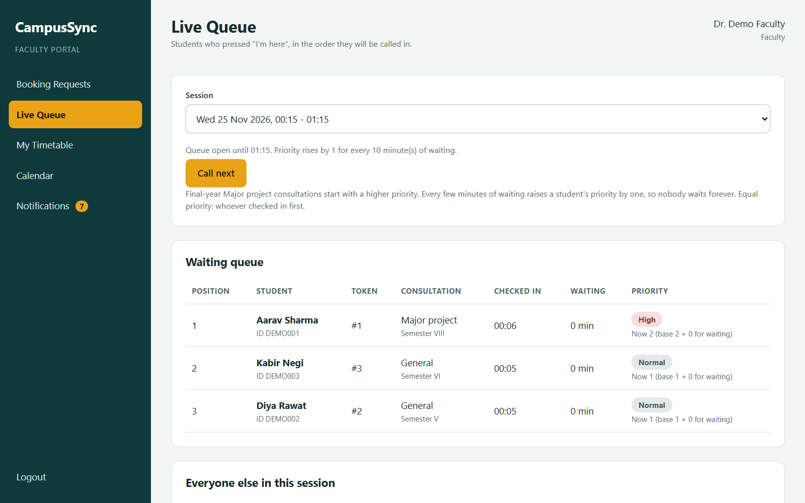
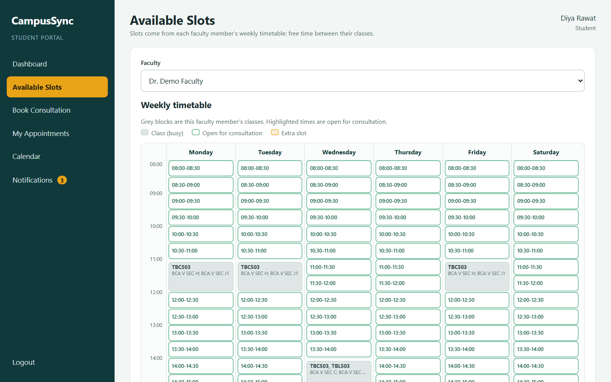
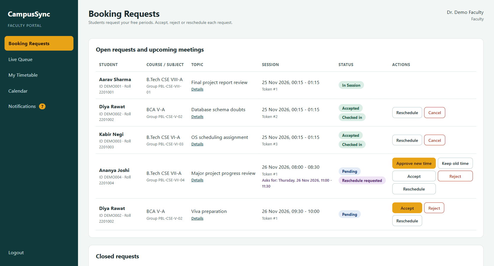

# CampusSync

Book consultation slots with faculty, and get a fair queue on the day of the meeting.

A project for the Operating Systems and DBMS course at Graphic Era, by Team Cipher.



## Why we built it

Students usually wait outside a faculty cabin without knowing when they will be seen, and a
final-year student with a project deadline waits as long as everyone else. CampusSync turns each
faculty member's free periods into bookable slots and runs a small queue for every slot:

- Free time between classes, taken from the university timetable, is offered as slots automatically.
- A student books a slot. The faculty member accepts, rejects or moves the request.
- On the day, students press **I'm here** and see their place in the queue.
- The faculty member calls them in one at a time from the **Live Queue**.

<p>
  
  
</p>

## Who goes next

A slot is served one student at a time, like a CPU running one process at a time.

- Major project consultations from semester VII or VIII start at priority 2. Everything else starts at 1.
- Waiting starts at check-in, not at booking. Every 10 minutes of waiting adds 1 to a student's
  priority (aging), so nobody gets overtaken forever.
- The highest priority goes first. Ties go to whoever checked in first, then to the lower token.

## How it works

- A Flask (Python) JSON API with a MySQL database. The pages are plain HTML, CSS and JavaScript.
- Each booking runs in one MySQL transaction with row locks (`SELECT ... FOR UPDATE`). A 3-seat slot
  never gets a fourth student, even when ten people book at the same moment. Locks are always taken in
  the same order (student, faculty, session) so two bookings cannot deadlock.
- 13 tables with primary key, foreign key, `UNIQUE` and `CHECK` constraints. For example, the database
  itself allows at most one student "In Session" per slot.
- Passwords are stored as scrypt hashes, and every request is checked on the server for role and ownership.
- 189 automated tests, including a race test (10 simultaneous bookings for 3 seats) and the queue rules.

## Running it locally (Windows)

You need Python 3.14 and MySQL 8.4 running as a Windows service.

```powershell
python -m venv .venv
.\.venv\Scripts\Activate.ps1
python -m pip install -r requirements.txt
python tools/setup_db.py           # database, app user and .env (asks for the MySQL root password)
flask --app app import-timetable   # loads the faculty timetables
flask --app app create-admin       # creates your admin login
```

Then double-click `start.bat` (or run `python app.py`) and open http://127.0.0.1:5000/.

`demo.bat` creates demo accounts with a slot that starts in a few minutes and writes their logins to
`demo-logins.txt`. Your own admin account is not changed.

Tests: `python -m unittest discover -s tests -v` (MySQL must be running).

The [user guide](docs/user-guide.md) explains what students, faculty and the admin can do.

## Project layout

```
app.py             Flask app and settings
auth.py            sign-up, login and roles
bookings.py        the booking transaction, student and faculty actions
queue_manager.py   check-in, priority with aging, call next
faculty.py         faculty accounts and consultation settings
timetable.py       timetable editing
slots.py           free-slot calculation
notifications.py   in-app notifications
schema.sql         tables and constraints
static/            the web pages
tests/             automated tests
tools/             database setup and timetable data scripts
```

## Limitations

- The semester is entered by the student, so Major project priority depends on what they report.
- Pages refresh every 15 seconds; there are no instant push updates.
- It runs on Flask's development server and is meant for a local demo, not a public deployment.

## Team

Team Cipher: Varuni Tomar (frontend) and Shivam Bani (backend and database).
